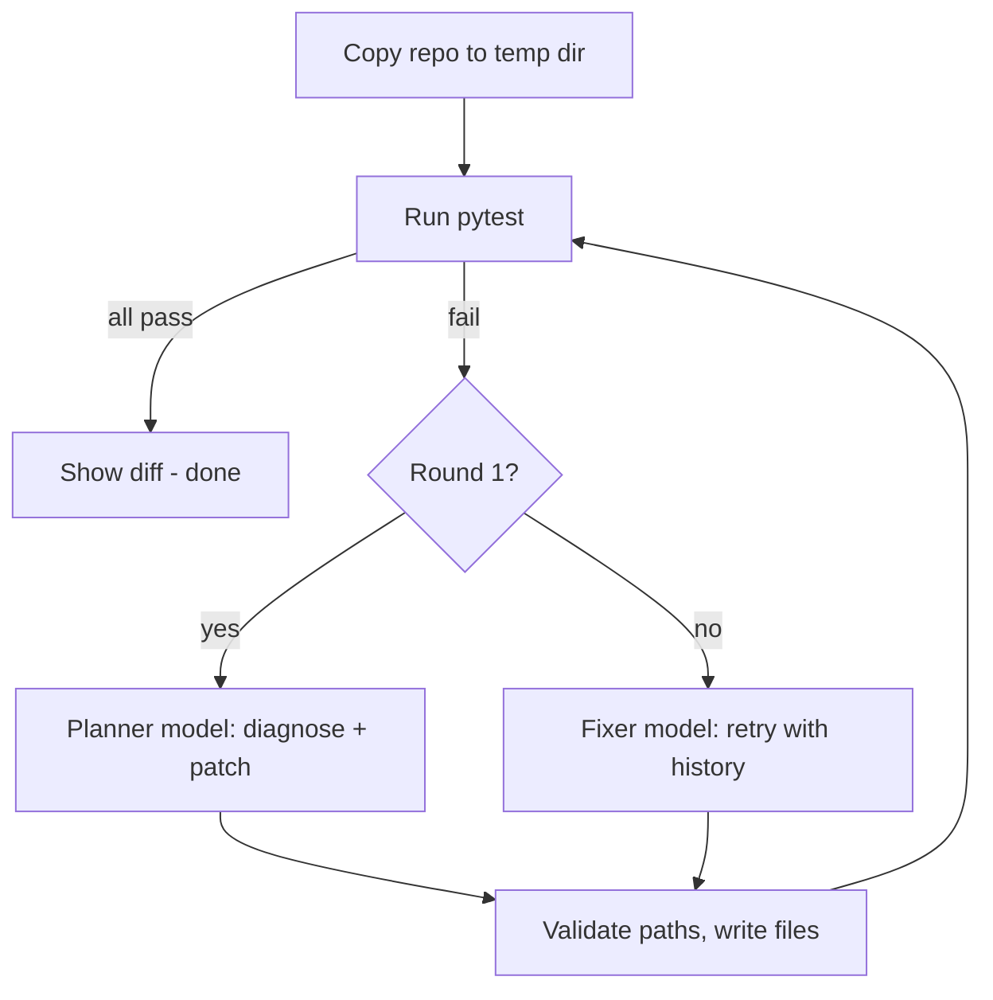

# Greenlight

[](LICENSE)

**An agent that turns red pytest suites green, using NVIDIA Nemotron on Nebius Token Factory.**

Built for the Nebius x NVIDIA Global AI Hackathon (Coding and Agentic Engineering track).

## Demo
- Live demo: **TODO: add URL after deploying**
- Video (under 3 min): **TODO: add YouTube URL**

## What it does
Point Greenlight at a Python repo with failing pytest tests. It runs the tests, sends the failures and source to a Nemotron model, applies the patch the model proposes, and reruns the tests until they pass (max 5 rounds). It then shows a unified diff of what changed. The web UI shows a traffic-light lamp (red, amber, green), a timeline of each step, and per-call model name, latency and token usage. Two demo repos are included: `sample_repo` (3 bugs in a calculator module) and `sample_repo_2` (4 bugs in a text-utilities module, one spanning two files).

## Architecture

- `agent.py`: the loop, prompt building, reply parsing, path validation (generator of events).
- `llm.py`: Token Factory client (OpenAI-compatible API), retries, `MAX_TOKENS`, latency/usage metadata.
- `server.py`: FastAPI app streaming events over server-sent events, plus demo abuse limits.
- `cli.py`: terminal front end, `--verbose` prints raw model replies.
- `static/index.html`: the UI.

## How we use NVIDIA Nemotron
- **Planner** (`PLANNER_MODEL`): a large Nemotron model does the first diagnosis, where reasoning matters most.
- **Fixer** (`FIXER_MODEL`): a smaller Nemotron model handles the quick retries in later rounds, with the history of previous attempts in the prompt.
- The model must reply with a single JSON object (`diagnosis` + full new file contents). Malformed or truncated replies are retried once and logged with the first 200 characters of the raw reply.
- **Models used:** planner `nvidia/Nemotron-3-Ultra-550b-a55b`; fixer `nvidia/NVIDIA-Nemotron-3-Nano-30B-A3B`.
- **Observed on the included repos:** both runs returned valid JSON on the first planner call; no fixer retry was needed. Each passed after the patch on test round 2.

## How Token Factory helped
All model calls go through Token Factory's OpenAI-compatible API (`llm.py`), so the code is a plain `openai` client with a base URL and key.
- **Observed web runs (2026-10-28):** `sample_repo` planner 3.0 s, 992 prompt / 1,012 completion tokens; UI total 3.6 s. `sample_repo_2` planner 3.9 s, 1,129 prompt / 1,203 completion tokens; UI total 4.8 s. No fixer call was needed. A separate CLI run of `sample_repo` took 18.307 s for the planner (992 prompt / 1,132 completion tokens); call latency varies between runs.
- **Credits/cost per full run:** **TODO: confirm actual billed credits in Token Factory.**

## Other Nebius services used
- **TODO:** e.g. Nebius Serverless Endpoints for hosting the demo (see [DEPLOY.md](DEPLOY.md)). List only what you actually used.

## Safety design
- Works on a temporary copy; the original repo is never modified.
- Every model-supplied path is validated: no absolute paths, no `..`, `.py` files only, must stay inside the repo.
- **Test files are read-only** (`test_*.py`, `*_test.py`, `conftest.py`): the tests define correct behaviour, so the model can't "fix" them by editing them.
- pytest runs with a 60 s timeout.
- Public demo limits: 3 runs per IP per hour, 1 concurrent run, `MAX_RUNS_PER_DAY` (default 100), all in memory.
- **Honest limitation:** pytest runs as a local subprocess, not in an isolated container. Model-written code executes with the server's privileges, so only run Greenlight on code you trust. The demo exposes only the bundled sample repos.

## Setup
```bash
python -m venv .venv && source .venv/bin/activate
pip install -r requirements.txt
cp .env.example .env   # fill in base URL, API key, and the two model IDs
```
Environment variables: `TOKEN_FACTORY_BASE_URL`, `TOKEN_FACTORY_API_KEY`, `PLANNER_MODEL`, `FIXER_MODEL`, optional `MAX_TOKENS` (default 4096), `MAX_RUNS_PER_DAY` (default 100).

## Run
```bash
python cli.py sample_repo              # terminal
python cli.py sample_repo_2 --verbose  # also print raw model replies
uvicorn server:app --port 8000         # web UI at http://localhost:8000
docker compose up --build              # container; see DEPLOY.md for Nebius
```
Point `cli.py` at any Python repo with pytest tests, but see the safety note above.

## Tests
```bash
python -m pytest
```
The tests use a mock model and need no API key. They cover the agent loop, path validation, truncated-JSON handling, both sample repos, and the server's rate limits (FastAPI TestClient with `agent.fix` mocked).

## Deployment
See [DEPLOY.md](DEPLOY.md) for building the image, Nebius Serverless Endpoints, and a generic container fallback.

## Limitations
- No sandbox isolation for running tests (see Safety design).
- Whole-file replacement only; very large files are truncated to 20,000 characters when sent to the model.
- Rate limits are in memory and per process (single replica only; reset on restart). The per-IP limit uses the first `X-Forwarded-For` value, which a client can spoof; the global and daily caps still bound spend.
- Only Python and pytest are supported.

## What's next
- Run tests in a container sandbox.
- Send diffs instead of whole files.
- CI integration (open a PR with the fix).

## Feedback notes (for the hackathon form)
See `submission/feedback.md`.

## License
MIT. See [LICENSE](LICENSE).
